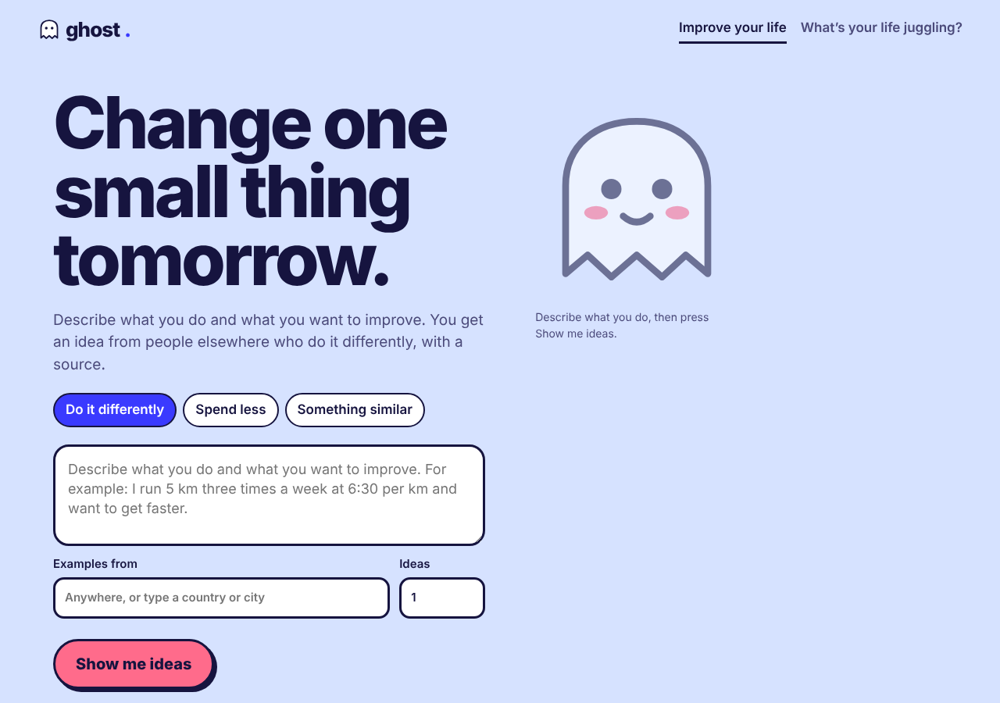
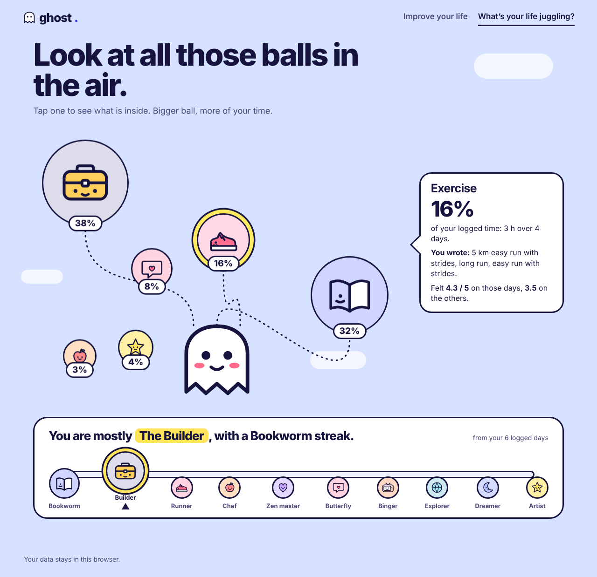

# Ghost

A small local web app with two pages.

- **Improve your life.** Describe an activity and get sourced ideas to do it differently, spend less, or find something similar. Start a trial, track one number, and log each day in a notebook.
- **What's your life juggling?** Your logged days become balls in the air (bigger ball, more time), with a type bar that names your main type and your streak type.




## Run

Requires Python 3.12 or later. The server uses only the standard library.

```
python -m ghost.server
```

Open http://127.0.0.1:8000.

Idea search runs through the [Claude Code](https://claude.com/claude-code) command line with your own login, so no API key is stored. Claude Code runs with only its web search and web fetch tools enabled.

## Design

- **Local only.** The server listens on 127.0.0.1. Your log and trials stay in the browser's local storage.
- **Checked answers.** Claude's reply must be JSON. An idea is kept only if it has a title, a summary and at least one benefit, and links must start with http or https (`ghost/coach.py`).
- **Safe previews.** Source-article previews open public web addresses only, so a link cannot make the server read your own network (`ghost/preview.py`).
- **Location box.** City names come from [GeoNames](https://www.geonames.org) (CC BY 4.0). Download the cities file and save it as `data/places.csv`; it is not in this repository.

## Tests

```
python -m pytest
```

## Layout

```
ghost/   server, search, prompt and answer checks, city and activity lookup
web/     index.html (Improve your life), pattern.html (What's your life juggling?)
tests/   one test file per module
```
